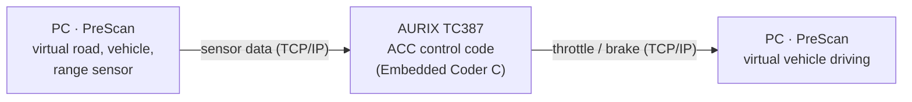
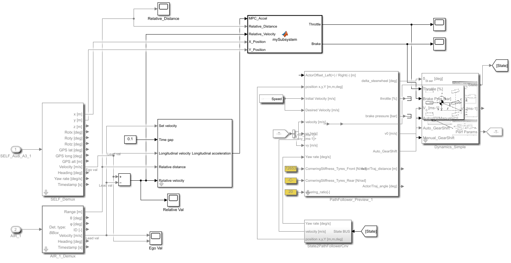
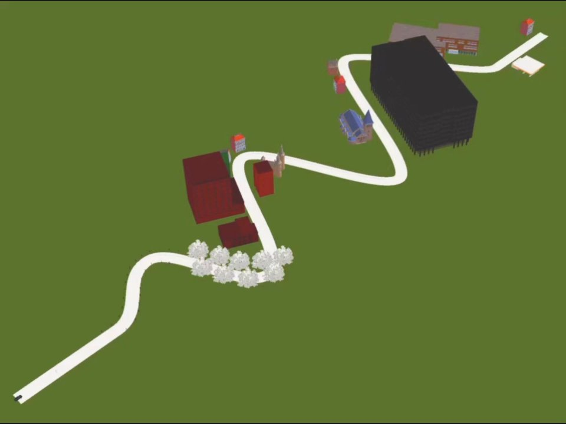
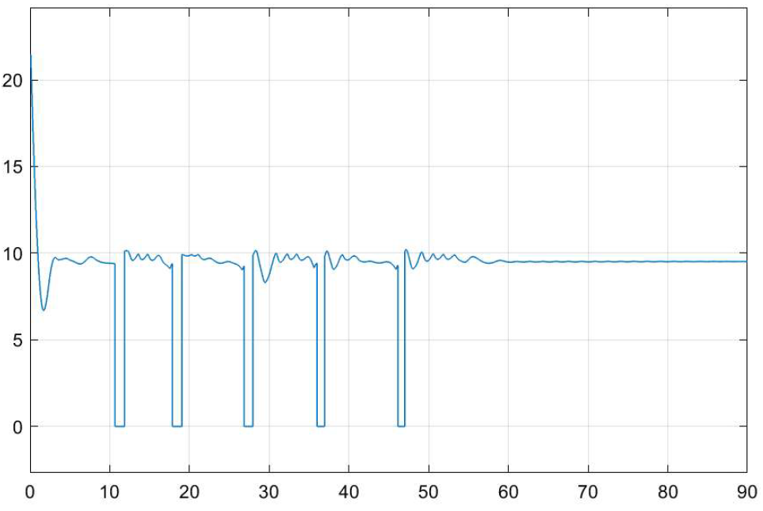

# ACC Controller on Infineon AURIX TC387

> Modern Control course · Infineon × Kookmin Univ. ACC Development Competition · 2025.09 – 2025.12 · 3-person team
> **4th place out of 14 teams**

An Adaptive Cruise Control (ACC) logic designed in MATLAB/Simulink, auto-generated into C code and deployed on an Infineon AURIX TC387. The controller is verified step by step from MIL (Model-in-the-Loop) to PIL (Processor-in-the-Loop) against a PreScan virtual vehicle.

---

## System Architecture

| Item | Detail |
|---|---|
| Modeling | MATLAB / Simulink |
| Code generation | Embedded Coder (Simulink → C) |
| Target MCU | Infineon AURIX TC387 (TriCore) |
| Simulation | PreScan (vehicle, road, sensors) |
| Interface | Ethernet TCP/IP between PreScan and TC387 |
| Timing | STM (System Timer) based execution time measurement |

  
   Simulink ACC model: sensor input → MPC / NSCC control blocks → throttle / brake output

---

## Control Algorithms

### MPC (Model Predictive Control)
- Predicts relative distance and speed to the preceding vehicle over a horizon and minimizes a cost function.
- Maximum speed constraint included; solved as a QP with the KWIK solver.

### PID
- Initial controller and performance baseline for MPC.

### NSCC (Navigation-based Smart Cruise Control, rule-based)
- In corners, the range sensor can lose the preceding vehicle.
- The target speed is adjusted from the map curvature so the gap is kept while the sensor is lost.

---

## Verification Flow (MIL → PIL)

| Stage | Method |
|---|---|
| MIL | Simulink model with PreScan; signals observed with Scope per section |
| Code generation | Embedded Coder C code built for TC387 |
| PIL | Generated code on TC387 in the loop with PreScan; RX/TX execution time measured with STM |

**Design note**: The TC387 FPU supports single precision only. `double` arithmetic falls back to software emulation, so the computation and communication interface types are implemented in `float`.

---

## Results

  
  
   Left: PreScan scenario with curved sections · Right: relative distance tracking (PID + MPC)

- Steady-state error of ACC **below 13%**
- Stable re-convergence after sensor loss in corners with NSCC, compared with PID only
- 4th place out of 14 teams

---

> Competition source code will be added after cleanup.
